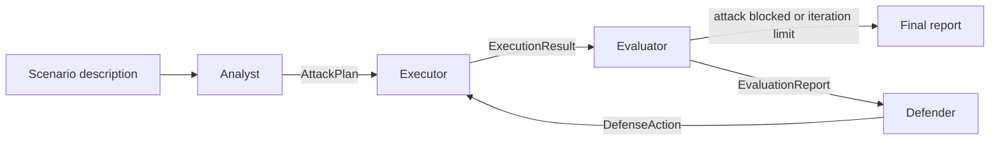

# AI-Based Multi-Agent Framework for Cyber Attack Scenario Testing

Engineering thesis project, Politechnika Opolska: *Wieloagentowy system sztucznej inteligencji do testowania i neutralizacji scenariuszy ataków w cyberbezpieczeństwie*.

Four LLM-driven agents run a closed loop against a deliberately vulnerable web application in an isolated Docker lab: they analyse the scenario, attack, evaluate the result, deploy a defense and attack again to verify that the defense works.

> Lab use only. The framework attacks nothing but the bundled target running in local containers.

## How the loop works



| Agent | Thesis name | Role | Decided by |
|---|---|---|---|
| Analyst | Analityk | classifies the scenario with MITRE ATT&CK and prepares the test plan | LLM |
| Executor | Wykonawca | runs the attack against the target and records every request | code |
| Evaluator | Ewaluator | computes whether the attack succeeded; the LLM adds severity, findings and recommendations | code + LLM |
| Defender | Obrońca | picks the next defense from a whitelist and applies it to the target | LLM + code |

Baseline for the experiments: **single-pass** mode applies one defense without re-testing, **closed-loop** mode re-attacks after every defense until the attack is blocked or `MAX_ITERATIONS` is reached.

## Design rules

- Agents exchange only the Pydantic models from `cyberloop/schemas.py`. Every LLM answer is validated against them and, if invalid, retried with the error as feedback.
- Facts are measured by code, judgements come from the LLM: whether an attack succeeded never depends on the model's opinion.
- The Defender chooses only from predefined defenses (`cyberloop/catalog.py`) and never writes arbitrary fixes.
- Reproducibility: temperature 0, a fixed seed and a pinned model version in `.env`.
- The LLM provider is a setting: a local model through Ollama by default, OpenAI or Anthropic as alternatives.

## Tech stack

Python 3.11+, LangGraph, LangChain integrations for Ollama / OpenAI / Anthropic, Pydantic, Docker. FastAPI, Streamlit and SQLite are planned for the API, the dashboard and the test history.

## Getting started (Windows, PowerShell)

Requirements: Python 3.11+, [Ollama](https://ollama.com), Docker Desktop (for the lab target).

```powershell
py -3.12 -m venv .venv
.\.venv\Scripts\Activate.ps1
pip install -e ".[dev,api,ui]"
Copy-Item .env.example .env
ollama pull qwen3.5:4b
pytest
python scripts/benchmark_llm.py
```

Run the vulnerable target the agents attack:

```powershell
docker compose up -d --build        # target on http://localhost:8080
python scripts/run_scenario.py      # run the loop, closed-loop vs single-pass
python scripts/run_experiments.py   # run the matrix into the history database
python scripts/export_results.py    # export the history to results/history.csv
uvicorn api.app:app                 # REST API on http://localhost:8000
streamlit run ui/app.py             # dashboard on http://localhost:8501
docker compose down
```

To use a cloud model instead, install the matching extra and edit `.env`:

```powershell
pip install -e ".[openai]"     # or ".[anthropic]"
```

```ini
LLM_PROVIDER=openai            # or anthropic
LLM_MODEL=<model name>
OPENAI_API_KEY=<key>           # or ANTHROPIC_API_KEY
```

## Project layout

```
cyberloop/
  config.py          settings from environment variables and .env
  schemas.py         handoff contracts between agents
  catalog.py         MITRE ATT&CK techniques, defense whitelist, target endpoints
  llm.py             chat model factory, structured calls with validation and retry
  target_facts.py    facts the framework uses to detect a successful attack
  target_control.py  enables and disables target defenses at runtime
  storage.py         SQLite history of runs
  factory.py         builds the agents and loop dependencies from settings
  agents/            Analyst, Executor, Evaluator, Defender
  orchestrator/      LangGraph closed loop and run state
target/              vulnerable web app under test (Flask + Docker)
api/                 FastAPI REST API over the run history
ui/                  Streamlit dashboard
scripts/
  benchmark_llm.py   latency and accuracy of the configured model on the Analyst task
  run_scenario.py    runs a scenario through the loop (closed-loop and single-pass)
  run_experiments.py runs the scenario x mode x model matrix into the history
tests/
docker-compose.yml   runs the target in a container on http://localhost:8080
```

## Roadmap

- [x] Foundation: contracts, provider-independent LLM layer, Analyst agent, LLM benchmark
- [x] Vulnerable target application in Docker with switchable defenses
- [x] Executor agent: runs SQL injection and records the results
- [x] Evaluator and Defender agents, LangGraph closed loop on SQL injection
- [x] Credential-guessing scenario with layered login defenses
- [ ] DDoS and phishing (web hardening) scenarios
- [x] SQLite run history, FastAPI REST API, Streamlit dashboard
- [x] Experiments: closed-loop vs single-pass across models, with CSV export

### On closed-loop vs single-pass

The three SQL-injection defenses are deliberately unequal: `waf_rules` and `input_validation`
are mitigations that an obfuscated payload can bypass, while `parameterized_queries` removes the
vulnerability. So the closed loop pays off exactly when the first chosen defense is insufficient:
it re-tests, sees the attack still works, and escalates until the target is protected, whereas a
single pass stops after one defense and may stay exploitable. For textbook SQL injection a capable
model picks the root fix first, so both modes protect the target in one step; the measurable gap is
expected to grow with weaker models and with attack types that need layered defenses. The closed
loop also always *verifies* the final state instead of assuming the defense worked.

## License

MIT
